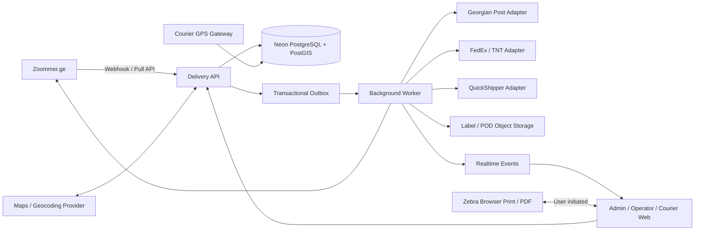
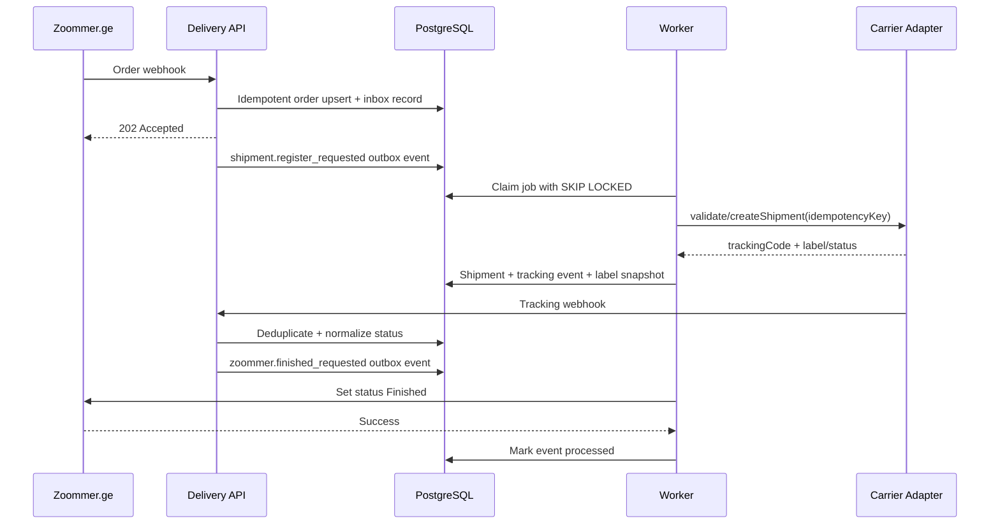

# სისტემის არქიტექტურა

## 1. მიზანი და საზღვრები

პლატფორმა არის Zoommer.ge-სა და მიწოდების არხებს შორის საოპერაციო ფენა. იგი:

1. იღებს Zoommer.ge-ს შეკვეთებს webhook-ით ან პერიოდული სინქრონიზაციით;
2. ამოწმებს და ამდიდრებს მისამართს/კოორდინატებს;
3. არეგისტრირებს გზავნილს საქართველოს ფოსტაში, FedEx/TNT-ში, QuickShipper-ში ან შიდა კურიერების გუნდში;
4. ინახავს ერთიან tracking timeline-ს;
5. ქმნის A5 PDF/ZPL ეტიკეტს, Code 128 ბარკოდს და QR კოდს;
6. ანაწილებს შეკვეთებს კურიერებზე და აჩვენებს მათ რუკაზე;
7. წარმატებული ჩაბარების შემდეგ Zoommer.ge-ში გზავნის `Finished` სტატუსს;
8. ყველა გარე ოპერაციას ასრულებს idempotent retry მექანიზმით და ინახავს audit trail-ს.

## 2. არქიტექტურული გადაწყვეტილება

პირველი production ვერსია იქნება **TypeScript modular monolith + ცალკე background worker**.

ეს ნიშნავს:

- ერთი საერთო domain model და ერთი PostgreSQL ბაზა;
- მკაფიო მოდულები და interface-ები, ერთმანეთის ცხრილებში პირდაპირი ჩარევის გარეშე;
- HTTP API მოკლე სინქრონული ოპერაციებისთვის;
- worker ხანგრძლივი და განმეორებადი ოპერაციებისთვის;
- მოგვიანებით მაღალი დატვირთვის მოდულის დამოუკიდებელ სერვისად გამოყოფის შესაძლებლობა.

მიკროსერვისებზე თავიდანვე გადასვლა ამ მოცულობისთვის არ არის საჭირო: გაზრდის deployment-ის, tracing-ისა და distributed transaction-ების სირთულეს მანამდე, სანამ რეალური დატვირთვა ამას მოითხოვს.

## 3. სამიზნე ტექნოლოგიური სტეკი

| ფენა | არჩევანი | დანიშნულება |
|---|---|---|
| Web | React + TypeScript, არსებული Vite აპის ეტაპობრივი განახლება | Admin/Operator/Courier responsive UI |
| API | Node.js + TypeScript, REST/OpenAPI 3.1 | ბიზნეს ოპერაციები და webhook-ები |
| Worker | Node.js + TypeScript | carrier polling, retry, Zoommer sync, label rendering |
| Database | Neon PostgreSQL + PostGIS + Drizzle ORM | ძირითადი transactional state და geospatial queries |
| Queue | საწყის ეტაპზე PostgreSQL outbox; დატვირთვის ზრდისას Redis/BullMQ | საიმედო background jobs |
| Realtime | SSE ან managed realtime gateway; GPS-ისთვის WebSocket gateway | dashboard/status/location updates |
| Files | S3-compatible object storage | ეტიკეტის PDF/ZPL და POD ფაილები |
| Maps | Google Maps Platform ან Mapbox — ერთი provider | autocomplete, reverse geocoding, map layers |
| Observability | structured logs, metrics, tracing, error monitoring | request/job/integration მონიტორინგი |

### Vercel და background jobs

Vercel Functions გამოიყენება stateless, სწრაფი API request-ებისთვის. მუდმივად გაშვებული BullMQ worker, გრძელვადიანი polling და GPS WebSocket კავშირები უნდა იმუშაოს ცალკე worker/runtime-ზე. MVP-ში queue შეიძლება PostgreSQL outbox-ზე ავაშენოთ და cron-ით/worker-ით დავამუშაოთ; Redis დაემატოს მაშინ, როცა throughput და near-realtime დაგვჭირდება.

### Neon კავშირები

- runtime/API-სთვის გამოიყენება pooled `DATABASE_URL`;
- migration/admin სამუშაოებისთვის — direct `DATABASE_URL_UNPOOLED`;
- Drizzle schema და versioned migrations არის მონაცემთა მოდელის ერთადერთი source of truth;
- development ცვლილებები კეთდება Neon branch-ზე და შემდეგ გადადის production branch-ზე.

## 4. მაღალი დონის ტოპოლოგია



## 5. Domain მოდულები

### Identity & Access

- users, sessions, roles და permissions;
- როლები: `admin`, `operator`, `courier`;
- permission შემოწმება ყოველთვის API-ზე; UI შეზღუდვა მხოლოდ UX-ია და უსაფრთხოების მექანიზმი არ არის.

### Order Intake

- Zoommer order-ის idempotent მიღება;
- source payload-ის validation და versioning;
- მისამართის ნორმალიზაცია;
- duplicate order-ის აღმოჩენა `(source, external_order_id)` უნიკალური გასაღებით.

### Shipment Orchestration

- შეკვეთიდან ერთი ან რამდენიმე shipment/package-ის შექმნა;
- carrier/service-ის არჩევა;
- carrier adapter-ის გამოძახება;
- tracking code-ის, ფასის, SLA-ს და label-ის შენახვა.

### Carrier Integration

- ყველა provider ერთიან `CarrierAdapter` contract-ს ახორციელებს;
- provider-ის status code გარდაიქმნება canonical shipment status-ად;
- raw request/response ინახება redacted ფორმით troubleshooting-ისთვის;
- credential არასდროს ხვდება frontend-ში ან log-ში.

### Tracking

- webhook-first, ხოლო webhook-ის არქონისას polling;
- duplicate event დაცვა provider event id/hash-ით;
- canonical timeline: `draft → registered → picked_up → in_transit → out_for_delivery → delivered`;
- გამონაკლისები: `delivery_failed`, `returned`, `cancelled`, `exception`.

### Dispatch & Courier

- ქალაქის/ზონის მიხედვით ფილტრაცია;
- ერთ ან რამდენიმე კურიერზე bulk assignment;
- assignment lifecycle და proof of delivery;
- courier location-ის live view, clustering და heatmap;
- მარშრუტების ოპტიმიზაცია ცალკე capability-ა და MVP-ს აუცილებელი ნაწილი არ არის.

### Labels & Printing

- label snapshot არის immutable: დაბეჭდილმა ეტიკეტმა მოგვიანებით შეცვლილი შეკვეთის გამო არ უნდა შეიცვალოს;
- გენერირდება A5 PDF და Zebra ZPL;
- Code 128 გამოიყენება tracking code-ის სწრაფი სკანირებისთვის;
- QR შეიცავს უსაფრთხო tracking URL-ს ან compact shipment identifier-ს, არა სრულ პერსონალურ მონაცემებს;
- print job ინახავს მცდელობებსა და შედეგს.

### Zoommer Status Sync

- `shipment.delivered` ქმნის outbox event-ს;
- worker აგზავნის Zoommer API-ში `Finished` სტატუსს;
- წარმატება ინახება integration attempt-ში;
- დროებითი შეცდომა იწვევს exponential backoff + jitter retry-ს;
- მუდმივი/validation შეცდომა გადადის dead-letter მდგომარეობაში და dashboard-ზე ქმნის alert-ს.

### Audit & Reporting

- მნიშვნელოვანი ცვლილებები ინახავს actor-ს, ძველ/ახალ მნიშვნელობას, request correlation id-ს და დროს;
- KPI dashboard კითხულობს ოპტიმიზებულ aggregate query/read model-ს;
- audit log append-only არის და ოპერატორს მისი შეცვლა არ შეუძლია.

## 6. ძირითადი ბიზნეს-ნაკადი



## 7. Role matrix

| მოქმედება | Admin | Operator | Courier |
|---|:---:|:---:|:---:|
| Dashboard და reports | ყველა | ოპერაციული | საკუთარი |
| შეკვეთების ნახვა | ყველა | ყველა | მხოლოდ მინიჭებული |
| carrier-ზე რეგისტრაცია | ✓ | ✓ | — |
| bulk assignment | ✓ | ✓ | — |
| label შექმნა/ბეჭდვა | ✓ | ✓ | საჭიროებისამებრ |
| delivery status/POD | ✓ | ✓ | მხოლოდ საკუთარი |
| მომხმარებლები/როლები | ✓ | — | — |
| provider credentials | ✓ | — | — |
| audit log | ✓ | შეზღუდული | — |

## 8. Non-functional მოთხოვნები

- API availability target: მინიმუმ 99.9% production ფაზაში;
- ყველა write request-ს აქვს idempotency/correlation id;
- webhook პასუხი სწრაფად აბრუნებს `2xx`, დამუშავება კი queue-ში ხდება;
- PII არ იწერება ჩვეულებრივ log-ში;
- GPS ინახება განსაზღვრული retention-ით და მხოლოდ სამუშაო shift-ისას;
- backups და point-in-time recovery მოწმდება პერიოდული restore drill-ით;
- accessibility: keyboard navigation, WCAG AA contrast, screen-reader labels;
- desktop და courier mobile layout ორივე first-class experience-ია;
- light/dark theme ინახება user preference-ში.

## 9. შემოთავაზებული repository სტრუქტურა

```text
apps/
  web/                    # React dashboard და courier UI
  api/                    # HTTP API, auth, webhooks
  worker/                 # outbox/queue consumers
packages/
  contracts/              # DTO, OpenAPI schemas, canonical enums
  domain/                 # business rules/use-cases
  db/                     # Drizzle schema და migrations
  carriers/               # adapter interface + provider implementations
  labels/                 # PDF/ZPL/barcode generation
  observability/          # logs, tracing, metrics
docs/
infra/
```

არსებული Vite/Vercel პროექტი ამ სტრუქტურაში ეტაპობრივად გადავა; ერთბაშად rewrite არ არის საჭირო.

## 10. მიწოდების ეტაპები

### Phase 1 — Foundation

- schema/migrations, RBAC, Order Intake;
- canonical statuses და audit log;
- mock carrier adapter-ები;
- PostgreSQL outbox/retry;
- A5 label preview და PDF;
- dashboard-ის ყველა ძირითადი route რეალური API contract-ებით.

### Phase 2 — External integrations

- Georgian Post, FedEx/TNT და QuickShipper sandbox/production adapters;
- signed webhooks და fallback polling;
- Zebra ZPL + Browser Print;
- Zoommer `Finished` sync;
- address autocomplete/reverse geocoding.

### Phase 3 — Courier operations

- courier mobile workflow, shift/location collection;
- city clusters/heatmap;
- bulk dispatch და POD;
- realtime dashboards.

### Phase 4 — Scale and intelligence

- Redis/BullMQ საჭიროების შემთხვევაში;
- route optimization;
- BI/read models;
- SLA alerts, carrier performance და automated carrier selection.

## 11. ღია გადაწყვეტილებები

იმპლემენტაციამდე ბიზნესისგან/პარტნიორებისგან საჭიროა:

1. Zoommer API-ის auth, order payload, webhook და status endpoint contract;
2. Georgian Post-ის merchant/API დოკუმენტაცია და sandbox credentials;
3. FedEx/TNT account-ის რეგიონული სერვისები, label stock და customs მოთხოვნები;
4. QuickShipper credentials, provider/service identifiers და webhook contract;
5. რუკის provider-ის არჩევანი და ბილინგის ლიმიტი;
6. Zebra მოდელები, DPI (`203/300`) და კავშირის ტიპი (`USB/LAN`);
7. GPS retention, თანამშრომლის თანხმობა და სამუშაო საათების პოლიტიკა;
8. ერთი order-ისთვის split shipment და partial delivery არის თუ არა საჭირო.

