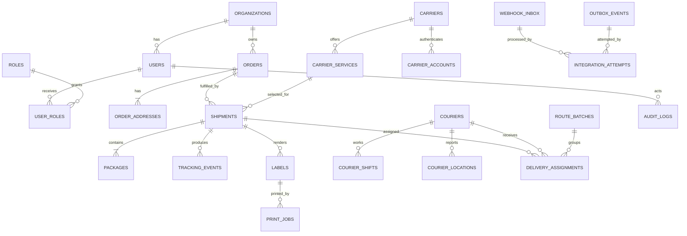

# PostgreSQL/PostGIS მონაცემთა მოდელი

## 1. პრინციპები

- primary key: `uuid`;
- დრო: ყოველთვის `timestamptz`, UI-ში `Asia/Tbilisi`;
- ფული: `numeric(12,2)` + `currency char(3)`;
- წონა: `numeric(10,3)`;
- კოორდინატი: `geography(Point, 4326)`;
- vendor-specific ცვლადი payload: `jsonb`; ძირითადი საძიებო ველები ცალკე typed column-ებია;
- ყველა foreign key-ზე იქმნება შესაბამისი index;
- soft delete გამოიყენება მხოლოდ იქ, სადაც ისტორიის შენარჩუნება საჭიროა;
- integration/audit event append-only არის.

## 2. Entity relationship model



## 3. ცხრილები

### Identity და tenancy

#### `organizations`

- `id uuid pk`
- `name text`
- `slug text unique`
- `timezone text default 'Asia/Tbilisi'`
- `created_at`, `updated_at`

პირველ ვერსიაში ერთი organization გვექნება, მაგრამ `organization_id` თავიდანვე იცავს მონაცემთა საზღვრებს და მომავალ B2B გაფართოებას ამარტივებს.

#### `users`

- `id uuid pk`
- `organization_id uuid fk`
- `email citext`
- `full_name text`
- `phone text`
- `auth_subject text unique`
- `status user_status`
- `last_login_at`, `created_at`, `updated_at`
- unique: `(organization_id, email)`

#### `roles`, `user_roles`

- `roles(code, name)`
- `user_roles(user_id, role_id, assigned_at, assigned_by)`
- unique: `(user_id, role_id)`

### Orders

#### `orders`

- `id uuid pk`
- `organization_id uuid fk`
- `source order_source`
- `external_order_id text`
- `status order_status`
- `delivery_type delivery_type`
- `recipient_name text`
- `recipient_phone text`
- `recipient_email text null`
- `payment_method payment_method`
- `cod_amount numeric(12,2)`
- `currency char(3) default 'GEL'`
- `declared_value numeric(12,2) null`
- `requested_delivery_at timestamptz null`
- `source_created_at timestamptz null`
- `metadata jsonb`
- `created_at`, `updated_at`
- unique: `(organization_id, source, external_order_id)`

#### `order_addresses`

- `id uuid pk`
- `order_id uuid fk`
- `kind address_kind` — `pickup`, `delivery`, `return`
- `formatted_address text`
- `country_code char(2)`
- `city text`
- `district text null`
- `street text null`
- `building text null`
- `apartment text null`
- `postal_code text null`
- `location geography(Point,4326) null`
- `provider_place_id text null`
- `accuracy address_accuracy`
- `instructions text null`
- unique: `(order_id, kind)`

მისამართის original text შეიძლება დარჩეს metadata-ში, ხოლო normalized field-ები ოპერაციულ ძიებას ემსახურება.

#### `order_items`

- `id uuid pk`
- `order_id uuid fk`
- `external_item_id text null`
- `sku text`
- `name text`
- `quantity integer check > 0`
- `unit_price numeric(12,2) null`
- `weight_kg numeric(10,3) null`
- `metadata jsonb`

### Carrier configuration და shipments

#### `carriers`

- `id uuid pk`
- `code carrier_code unique` — `georgian_post`, `fedex_tnt`, `quickshipper`, `internal`
- `name text`
- `adapter_version text`
- `active boolean`
- `capabilities jsonb`

#### `carrier_services`

- `id uuid pk`
- `carrier_id uuid fk`
- `external_service_code text`
- `name text`
- `delivery_type delivery_type`
- `domestic boolean`
- `active boolean`
- `config jsonb`
- unique: `(carrier_id, external_service_code)`

#### `carrier_accounts`

- `id uuid pk`
- `organization_id uuid fk`
- `carrier_id uuid fk`
- `environment integration_environment`
- `secret_reference text`
- `account_reference text null`
- `active boolean`
- `config jsonb`
- unique: `(organization_id, carrier_id, environment)`

`secret_reference` მიუთითებს secret manager/environment key-ზე; API token/password ბაზაში plain text-ად არ ინახება.

#### `shipments`

- `id uuid pk`
- `organization_id uuid fk`
- `order_id uuid fk`
- `carrier_service_id uuid fk null`
- `external_shipment_id text null`
- `tracking_code text null`
- `status shipment_status`
- `idempotency_key text`
- `price numeric(12,2) null`
- `currency char(3) default 'GEL'`
- `sla_due_at timestamptz null`
- `registered_at`, `picked_up_at`, `delivered_at`, `cancelled_at`
- `last_error_code`, `last_error_message`
- `metadata jsonb`
- `created_at`, `updated_at`
- unique: `(organization_id, idempotency_key)`
- unique partial: `(carrier_service_id, external_shipment_id)` where external id is not null

Tracking code-ის უნიკალურობა provider scope-ში უნდა შემოწმდეს, რადგან სხვადასხვა provider თეორიულად ერთსა და იმავე სტრიქონს იყენებდეს.

#### `packages`

- `id uuid pk`
- `shipment_id uuid fk`
- `sequence_no integer`
- `weight_kg numeric(10,3)`
- `length_cm`, `width_cm`, `height_cm numeric(10,2)`
- `package_type text null`
- `external_package_id text null`
- `tracking_code text null`
- unique: `(shipment_id, sequence_no)`

### Tracking

#### `tracking_events`

- `id bigint identity pk`
- `shipment_id uuid fk`
- `provider_event_id text null`
- `provider_status text`
- `canonical_status shipment_status`
- `description text null`
- `event_at timestamptz`
- `location_text text null`
- `location geography(Point,4326) null`
- `raw_payload jsonb`
- `received_at timestamptz`
- unique partial: `(shipment_id, provider_event_id)` where provider event id is not null

თუ provider event id-ს არ გვაძლევს, deduplication key მიიღება stable payload fields-ის hash-ით.

### Courier operations

#### `couriers`

- `id uuid pk`
- `organization_id uuid fk`
- `user_id uuid fk unique`
- `employee_code text`
- `vehicle_type text null`
- `vehicle_plate text null`
- `home_city text null`
- `active boolean`
- unique: `(organization_id, employee_code)`

#### `courier_shifts`

- `id uuid pk`
- `courier_id uuid fk`
- `started_at`, `ended_at`
- `start_location`, `end_location geography(Point,4326) null`
- `status shift_status`

#### `courier_locations`

- `id bigint identity pk`
- `courier_id uuid fk`
- `shift_id uuid fk`
- `location geography(Point,4326)`
- `accuracy_m numeric(8,2) null`
- `speed_mps numeric(8,2) null`
- `heading numeric(6,2) null`
- `recorded_at timestamptz`
- `received_at timestamptz`

დიდი მოცულობისას ცხრილი `recorded_at`-ით თვიურად partition-დება და retention job ძველ წერტილებს შლის ან aggregate-ად ინახავს.

#### `route_batches`

- `id uuid pk`
- `organization_id uuid fk`
- `city text`
- `service_date date`
- `status route_status`
- `created_by uuid fk`
- `created_at`, `updated_at`

#### `delivery_assignments`

- `id uuid pk`
- `shipment_id uuid fk`
- `courier_id uuid fk`
- `route_batch_id uuid fk null`
- `status assignment_status`
- `sequence_no integer null`
- `assigned_by uuid fk`
- `assigned_at`, `accepted_at`, `completed_at`
- `failure_reason text null`
- unique partial: `(shipment_id)` for active assignment statuses

### Label და printing

#### `labels`

- `id uuid pk`
- `shipment_id uuid fk`
- `version integer`
- `format label_format` — `pdf_a5`, `zpl`
- `storage_key text`
- `content_hash text`
- `template_version text`
- `dpi integer null`
- `snapshot jsonb`
- `created_at`
- unique: `(shipment_id, version, format, dpi)`

#### `print_jobs`

- `id uuid pk`
- `label_id uuid fk`
- `requested_by uuid fk`
- `printer_name text null`
- `status print_status`
- `attempt_count integer`
- `error_message text null`
- `requested_at`, `printed_at`

### Reliable integrations

#### `webhook_inbox`

- `id uuid pk`
- `provider integration_provider`
- `external_event_id text null`
- `payload_hash text`
- `headers jsonb` — allowlist/redacted
- `payload jsonb`
- `signature_valid boolean`
- `status inbox_status`
- `received_at`, `processed_at`
- unique partial: `(provider, external_event_id)` where id is not null
- unique fallback: `(provider, payload_hash)`

#### `outbox_events`

- `id uuid pk`
- `organization_id uuid fk`
- `aggregate_type text`
- `aggregate_id uuid`
- `event_type text`
- `payload jsonb`
- `status outbox_status`
- `attempt_count integer default 0`
- `available_at timestamptz`
- `locked_at timestamptz null`
- `locked_by text null`
- `processed_at timestamptz null`
- `last_error text null`
- `created_at`

Business transaction და outbox insert ერთ transaction-ში სრულდება, რათა მონაცემი ჩაიწეროს ან ორივეგან, ან არც ერთგან.

#### `integration_attempts`

- `id bigint identity pk`
- `provider integration_provider`
- `operation text`
- `entity_type text`
- `entity_id uuid`
- `outbox_event_id uuid fk null`
- `request_id text`
- `attempt_no integer`
- `http_status integer null`
- `success boolean`
- `duration_ms integer`
- `error_code`, `error_message`
- `request_summary jsonb`
- `response_summary jsonb`
- `created_at`

#### `audit_logs`

- `id bigint identity pk`
- `organization_id uuid fk`
- `actor_user_id uuid fk null`
- `actor_type actor_type`
- `action text`
- `entity_type text`
- `entity_id uuid null`
- `before_data jsonb null`
- `after_data jsonb null`
- `correlation_id text`
- `ip_hash text null`
- `created_at`

## 4. Enum-ების საწყისი მნიშვნელობები

```text
order_status:
  new, validated, ready_for_registration, processing, completed,
  cancelled, on_hold

shipment_status:
  draft, registration_pending, registered, picked_up, in_transit,
  out_for_delivery, delivered, delivery_failed, exception,
  returned, cancelled

assignment_status:
  assigned, accepted, picked_up, in_progress, delivered,
  failed, returned, cancelled

outbox_status:
  pending, processing, succeeded, retry_scheduled, dead_letter
```

Provider status პირდაპირ enum-ში არ შედის; იგი `provider_status`-ში ინახება და adapter canonical status-ზე აკონვერტირებს.

## 5. აუცილებელი indexes

```sql
create index orders_status_created_idx
  on orders (organization_id, status, created_at desc);

create index orders_active_sla_idx
  on orders (organization_id, requested_delivery_at)
  where status in ('new', 'validated', 'ready_for_registration', 'processing');

create index shipments_status_updated_idx
  on shipments (organization_id, status, updated_at desc);

create index tracking_events_shipment_time_idx
  on tracking_events (shipment_id, event_at desc);

create index order_addresses_location_gist_idx
  on order_addresses using gist (location);

create index courier_locations_location_gist_idx
  on courier_locations using gist (location);

create index courier_locations_courier_time_idx
  on courier_locations (courier_id, recorded_at desc);

create index assignments_courier_status_idx
  on delivery_assignments (courier_id, status, assigned_at desc);

create index outbox_ready_idx
  on outbox_events (available_at, created_at)
  where status in ('pending', 'retry_scheduled');
```

## 6. Retry/outbox concurrency

Worker jobs იღებენ მოკლე transaction-ით:

```sql
select id
from outbox_events
where status in ('pending', 'retry_scheduled')
  and available_at <= now()
order by available_at, created_at
for update skip locked
limit 50;
```

ამის შემდეგ rows ინიშნება `processing`-ად და network call transaction-ის გარეთ სრულდება. `SKIP LOCKED` queue-like table-ზე რამდენიმე worker-ს საშუალებას აძლევს ერთი job ორჯერ არ აიღოს.

Retry ინტერვალი:

```text
delay = min(max_delay, base_delay * 2^attempt) + random_jitter
```

- `429`: `Retry-After` არის პრიორიტეტული;
- `408/425/5xx/network timeout`: retry;
- `400/401/403/404/422`: ჩვეულებრივ dead-letter ან credential/config alert;
- carrier create request timeout-ის შემდეგ ხელახალ create-მდე უნდა შემოწმდეს idempotency key/reference, რათა duplicate shipment არ შეიქმნას.

## 7. Geospatial query მაგალითები

ახლო active shipment-ების პოვნა:

```sql
select s.id
from shipments s
join orders o on o.id = s.order_id
join order_addresses a on a.order_id = o.id and a.kind = 'delivery'
where s.status in ('registered', 'picked_up', 'in_transit', 'out_for_delivery')
  and st_dwithin(
    a.location,
    st_setsrid(st_makepoint(:lng, :lat), 4326)::geography,
    :radius_meters
  );
```

რუკის viewport query ყოველთვის bounding box/radius-ით უნდა შეიზღუდოს; ყველა GPS წერტილის frontend-ში დაბრუნება დაუშვებელია.

## 8. Security და retention

- `organization_id` ყველა tenant-owned ცხრილში;
- RLS ან API-enforced tenant scoping; production-მდე automated isolation tests;
- phone/address-ის სრული მნიშვნელობა მხოლოდ შესაბამის როლებს;
- secret-ები ბაზაში არ ინახება;
- raw payload-ებში PII field allowlist/redaction;
- courier GPS raw retention წინასწარ განისაზღვრება, მაგალითად 30–90 დღე;
- audit/integration logs ინახება უფრო დიდხანს, მაგრამ PII მინიმიზებული ფორმით.

## 9. არსებული სქემიდან მიგრაცია

მიმდინარე `delivery_orders` და `order_events` რჩება მოქმედი, სანამ:

1. ახალი tables migration-ებით შეიქმნება;
2. backfill გადაიტანს არსებულ შეკვეთებს;
3. API დროებით dual-read/dual-write რეჟიმში იმუშავებს;
4. მონაცემთა რაოდენობა და checksums შედარდება;
5. ახალი მოდელი გახდება primary;
6. ძველი tables მხოლოდ შეთანხმებული retention პერიოდის შემდეგ და ცალკე migration-ით გაუქმდება.

